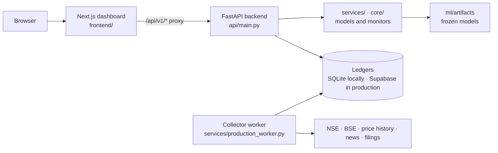

# IPO Intelligence

**OpenBell** — an IPO research and post-listing monitoring platform for Indian equity markets (NSE/BSE).

It does two things:

- **Module 1 · Pre-listing research.** Follows an IPO through its bidding window, saves a frozen model's probability of a positive listing open *before* the application cutoff, and later checks that saved call against the verified exchange opening price.
- **Module 2 · Post-listing monitoring.** Watches newly listed shares day by day using eligible prices, dated news and exchange filings, records a dated Hold/Sell call, and matches each call with the price that actually followed.

Every forecast is stored with its inputs, model version and timestamp, so historical replays and genuine pre-close calls are never mixed.

---

## Features

- **Market Today**: open, upcoming and recently listed IPOs with subscription, GMP and offer details
- **IPO research and comparison**: per-issue probability, inputs, comparable past IPOs and an application screen (Apply Tier 1 / Tier 2 / Skip)
- **Model performance**: locked benchmark results, cohort-by-cohort accuracy and model lineage
- **Module 2 monitor**: daily calls, intraday context and a saved-call vs. actual-price chart (1, 5 and 30 sessions)
- **Data provenance**: issuer identity checks, source clocks and SHA-256 hashes on archived evidence

## Architecture



| Layer | Stack |
| --- | --- |
| Frontend | Next.js 14, React 18, Tailwind CSS |
| Backend | Python 3.13, FastAPI, Uvicorn |
| Modelling | scikit-learn 1.9, pandas, NumPy (joblib artifacts) |
| Storage | SQLite (local), Supabase Postgres and Storage (production) |
| Deployment | Docker, Render, Vercel |

## Models and results

**Module 1** (`M1_V1_FROZEN_WITH_RECOVERED_INPUTS`) is a stacked classifier trained on 290 IPOs from 2021–2025. It has five expert views (Base, Base + Macro, Financial + Macro, Trajectory, GMP-only) and a logistic-regression meta-model over 23 features, with a fixed 0.50 cutoff. The artifact is `ml/artifacts/module1_2026_standard_classifier_research_20261025.joblib`, and its exact features and parameters are exposed by `services/model_lineage.py`.

| Cohort | Direction correct |
| --- | --- |
| 2026 development cohort (69 IPOs) | 56/69 (81.2%) |
| Recent verified replay (24 IPOs) | 17/24 (70.8%) |

The application screen (`services/retail_hni_economics.py`) is separate from the direction model. On the 69-IPO cohort it applied to 18 IPOs, all of which opened positive, but it also skipped 28 of the 46 winners.

**Module 2** (`M2_R1_WITH_DATED_FILINGS`) is a deterministic daily price and filing monitor. On 132 matured 2025–2026 IPOs it scored 63/132 (47.7%), versus 77/132 (58.3%) for always-sell. **It has not demonstrated a trading edge.** Learned next-session and five-session models are kept as research and shadow logging only.

> These are historical evaluations, not guarantees of future accuracy. Probabilities are not calibrated return forecasts, and nothing here is investment advice.

## Repository layout

| Path | Contents |
| --- | --- |
| `api/` | FastAPI app, routes and worker lifecycle |
| `core/` | Feature engineering, predictor, similarity, attribution and monitor engines |
| `services/` | Data feeds, Module 1/2 services, forecasting, evidence and storage sync |
| `ml/` | Data collection, recovery, research, training and evaluation scripts; `ml/artifacts/` holds frozen models |
| `data/` | Curated datasets (IPO master, subscription, market and post-listing prices, audit snapshots) |
| `output/` | Locked evaluation reports and evidence read by the app at runtime |
| `db/` | Supabase migrations, ledger adapter and sync scripts |
| `frontend/` | Next.js dashboard and API proxy route |
| `tests/` | Python test suite (`frontend/tests/` holds the Node tests) |

## Run locally

**Requirements:** Python 3.13 (the version used by the Docker images), Node.js 18.17+ and npm.

The frozen models need the exact library versions in `requirements-runtime.txt` (scikit-learn 1.9.0). The archived pre-close return model was saved with scikit-learn 1.5.2, so on this runtime the app turns that experimental return forecast off automatically; everything else is unaffected.

Locally, the backend uses SQLite under `data/telemetry/` (created on first run). Supabase is optional.

**1. Backend**

```bash
python -m venv .venv
# Windows: .venv\Scripts\activate   ·   macOS/Linux: source .venv/bin/activate
pip install -r requirements.txt -r requirements-runtime.txt
cp .env.example .env          # optional: add Supabase keys to mirror local ledgers
uvicorn api.main:app --host 127.0.0.1 --port 8000 --workers 1
```

Keep `--workers 1`. The API process also runs the data collectors, and extra workers would poll sources twice.

**2. Frontend** (in a second terminal)

```bash
cd frontend
npm ci
npm run dev
```

Open http://localhost:3000. Health check: http://127.0.0.1:8000/api/v1/health.

## Configuration

| Variable | Where | Purpose |
| --- | --- | --- |
| `SUPABASE_URL` | backend | Supabase project URL (required in production) |
| `SUPABASE_SERVICE_ROLE_KEY` | backend | Server-side key for ledgers and storage. Never expose it to the browser. |
| `OPENBELL_STORAGE_BACKEND` | backend | `sqlite` (local default) or `supabase` (set by the Dockerfiles) |
| `OPENBELL_COLLECTORS_ENABLED` | backend | `1` to run scheduled collectors in that process |
| `LIVE_DATA_TTL_MINUTES` | backend | Market Today cache lifetime (default `30`) |
| `OPENBELL_APP_URL` | frontend | Public URL of the FastAPI backend, used by the `/api/v1` proxy |

## Deployment

Production runs three pieces, all using Supabase for storage: the **FastAPI API** (`Dockerfile`, on Render), the **Next.js frontend** (on Vercel) and one **collector worker** (`Dockerfile.worker`, or `python -m services.production_worker` on any machine).

### Step 1 — Prepare Supabase

1. Create a Supabase project and copy its URL and **service role** key.
2. In the SQL editor, run `db/migrations/002` → `005` in order.
3. From your machine, with `.env` filled in and no `.db` files in `data/telemetry/`:
   ```bash
   python -m db.install_native_ledgers --apply   # create the 36 typed ledger views
   python -m services.cloud_assets --publish     # upload runtime evidence to the private bucket
   ```

Run these **before** the API's first start, otherwise the API creates plain tables where the installer expects views. A new Supabase project starts with an empty saved-call history; new calls accumulate once the collector runs.

### Step 2 — Backend on Render

Create a **Web Service** from this repo: language **Docker**, Dockerfile `./Dockerfile`, region **Singapore**, environment variables `SUPABASE_URL` and `SUPABASE_SERVICE_ROLE_KEY`, health check path `/api/v1/health`.

### Step 3 — Frontend on Vercel

Import the repo with **root directory `frontend`** and set `OPENBELL_APP_URL` to the Render URL, e.g. `https://your-api.onrender.com`. Leave `NEXT_PUBLIC_API_BASE_URL` unset; the browser calls same-origin `/api/v1`.

### Step 4 — Collector

Run exactly one collector. Either locally (`python -m services.production_worker`, collects while it runs) or always-on from `Dockerfile.worker` on a paid Render worker or a VM. A Supabase lease stops two collectors running at once.

### Check the deployment

1. `GET /api/v1/health` should report `storage.backend = supabase_api` and, while a collector runs, `external_lease_active = true`.
2. Open Market Today, Research, Compare, Performance and Module 2 from the deployed URL.
3. During market hours, check the collector logs for a completed collection slot. A homepage that loads does not prove collection is working.

## Testing

```bash
pytest -q                          # Python tests
cd frontend && node --test tests/*.test.mjs && npm run build
```

Some research tests need large local archives that are not in Git (`data/archive/`, `data/telemetry/`) and are skipped or fail without them.

## Limitations

- GMP and some subscription data come from unofficial aggregators, and those sources are not independent confirmations.
- Collectors follow weekday market hours. Exchange holidays and special sessions need separate calendar checks.
- Missing evidence is reported as missing; it is never filled with invented values.
- The free Render instance sleeps when idle, so the first request after a quiet spell can take about a minute.

## Paper

The conference manuscript source is in `output/conference_revision/`.
